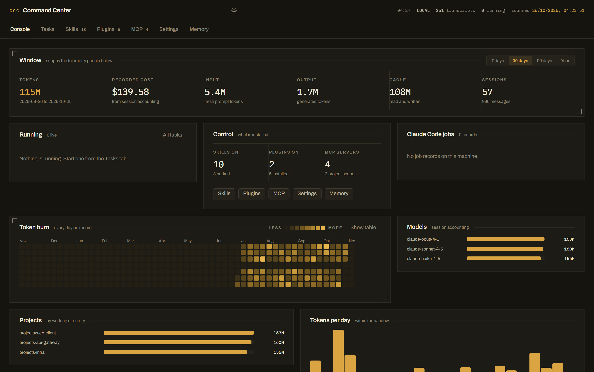

# Claude Command Center

A local control room for your Claude Code installation.

It reads the real files Claude Code uses — `~/.claude/settings.json`,
`~/.claude.json`, the skill folders, the plugin registry, the memory files, and
every session transcript — and lets you see and change them from a browser
instead of the CLI.



Everything runs on your machine. Nothing is uploaded, and there is no account.

## What it does

| Page | Reads | Writes |
|---|---|---|
| Console | every transcript under `~/.claude/projects`, the job records, the running tasks | nothing |
| Tasks | the job records, the processes on the machine, the tasks this dashboard started | starts and stops headless `claude` runs |
| Skills | `~/.claude/skills`, `~/.claude/skills-off` | moves a folder between the two |
| Plugins | `plugins/installed_plugins.json`, marketplace catalogue | `enabledPlugins` in `settings.json` |
| MCP servers | `mcpServers` in `~/.claude.json` (global + per project) | `~/.claude.json`, parked servers file |
| Settings | `settings.json`, `settings.local.json`, `CLAUDE.md`, `.claude.json`, access config | all of them, with a backup each time |
| Memory | `~/.claude/memory` and every project memory folder | the memory files themselves |

## Install and run

Requires **Node.js 18+** and a working Claude Code CLI.

```bash
git clone https://github.com/aswathas/claude-command-center.git
cd claude-command-center
npm install
npm run build      # once, or after changing anything under src/
npm start          # serves the built app and the API on http://127.0.0.1:8787
```

For development with hot reload:

```bash
npm run dev        # API on 8787, Vite dev server on 5173
```

`start.cmd` (Windows) does the same thing in one click.

### Pointing it at a different Claude Code install

By default the dashboard reads `~/.claude`. Override that with two environment
variables — useful for testing against a scratch install, or for running a
second dashboard against a different profile:

```bash
CLAUDE_HOME=/path/to/.claude \
CLAUDE_JSON=/path/to/.claude.json \
npm start
```

## Running tasks from your phone

Settings → Phone access switches the console from loopback-only onto your
network. When it is on:

- the console answers on your machine's LAN address, printed in the terminal
  and shown as a QR code in the panel;
- every API call needs the access code, which is also printed in the terminal
  and can be rotated from the panel;
- the Tasks page can start a headless `claude` run in any project the machine
  already knows about, stream its output, and stop it.

Switch it back off and the console closes to the outside world immediately.

Tasks started this way are ordinary `claude -p` runs with bypassed
permissions, writing only to `~/.claude/.command-center/tasks`. Stopping one
kills its process tree.

## Token telemetry

Claude Code writes one JSONL transcript per session. Each assistant message
carries a `usage` block, and each session ends with a `cost-state` record that
holds Claude Code's own accounting.

The indexer:

- reads every transcript once and caches the result per file, keyed by
  (mtime, size), so a rescan only re-reads what changed;
- deduplicates messages on `(sessionId, message.id)`, because the same API
  message can be written more than once in a file;
- takes cost and the per-model split from the session's own `cost-state`
  record when one exists, and from the message stream otherwise;
- attributes a session's cost to a real day — the last message seen, then the
  session start time. No synthetic buckets.

The first scan of ~1 GB of transcripts takes about nine seconds. Later scans
reuse the cache. The Overview page has a **Rebuild transcript index** button
when you want a forced re-read.

## Safety rules the code enforces

- The server binds to `127.0.0.1`. Nothing listens on the network until you
  explicitly switch phone access on.
- `~/.claude/credentials.json` is never read or served.
- Secret-looking values (anything whose key matches token / secret / key /
  auth / cookie, and any value shaped like a provider key) are masked before
  they leave the process. They show as `125 chars · hidden`.
- Saving the raw `settings.json` editor merges the masked placeholders back
  into the stored secrets, so a round-trip can never overwrite a real token
  with a placeholder.
- Every write to a config file keeps a timestamped backup beside it
  (`settings.json.bak.<timestamp>`).
- Writes are restricted to the Claude home, the app cache, and `~/.claude.json`.
- Disabling a skill or an MCP server moves it aside; it is never deleted.

## Layout

```
server/
  index.js            Express API
  claude-home.js      paths, guarded read/write, backups
  redact.js           secret masking
  usage-index.js      transcript scanning and aggregation
  services/           skills, plugins, mcp, settings, memory
src/
  App.tsx             shell, navigation, theme
  pages/              one file per page
  components/         heatmap, charts, toggle, tooltip, toast
  styles/             design tokens and layout
```

## Design notes

Dark-first instrument panel: deep blue-slate surfaces, Archivo for type, IBM
Plex Mono for data. Magnitude uses a single-hue sequential ramp; identity uses
the fixed categorical order from the dataviz palette, never a rainbow. Every
chart has a hover and focus readout and a table alternative, and the whole
thing respects `prefers-reduced-motion`.

`DESIGN.md` is the full design specification — palette, type scale, layout,
components, motion, and the anti-references this thing deliberately avoids.

## License

MIT. See [LICENSE](LICENSE).
